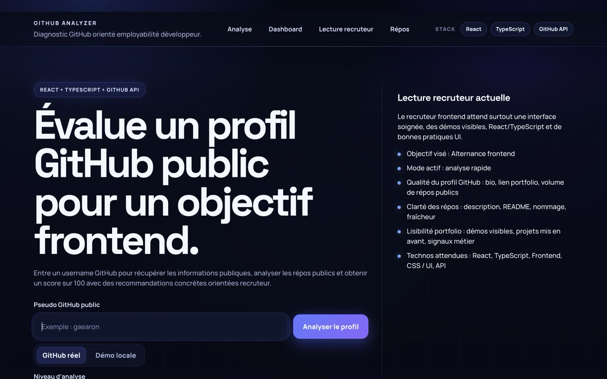
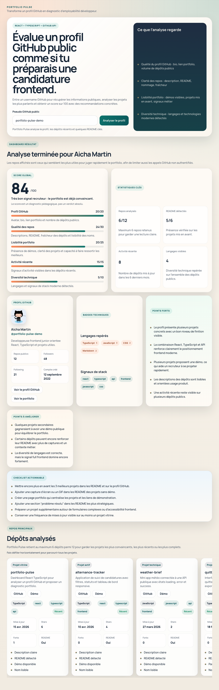
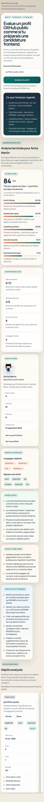

# GitHub Profile Analyser

GitHub Profile Analyser turns a public GitHub profile into a developer employability diagnosis.

## Live Demo

https://github-profileanalyser.vercel.app/

## Pitch

This React and TypeScript application analyses a public GitHub profile, selects the most representative repositories, and generates:

- an overall score out of 100;
- a summary of the profile's strongest signals;
- areas for improvement;
- a concrete checklist to make the portfolio more convincing.

## Project Goal

This project was designed as a frontend portfolio project to demonstrate:

- building a React application with TypeScript and Vite;
- consuming a real API;
- handling `loading`, `error`, and `success` states;
- turning API data into useful business logic;
- building a clear, responsive dashboard;
- organizing a frontend project cleanly.

## Current Features

### V0

- Vite React TypeScript project setup;
- dedicated folder structure for components, services, utilities, and types;
- custom global CSS base;
- versioned project roadmap.

### V1

- public GitHub username search;
- simple username validation;
- public GitHub profile fetching;
- public repository fetching;
- README detection on public repositories;
- score calculation out of 100 with category details;
- profile information display;
- analysed repository display;
- automatic recommendations: strengths, improvements, and actionable checklist;
- responsive dashboard interface.

### V1.1

- empty state before search with example usernames;
- local demo mode for screenshots and presentations;
- clearer error messages;
- smarter sorting of analysed repositories;
- language badges and stack signals;
- horizontally scrollable repository section;
- Vercel deployment preparation.

### V2

- detailed README content analysis across detected repositories;
- README decoding from the GitHub API;
- key section detection: installation, stack, features, screenshots, demo, and roadmap;
- README score per repository out of 10;
- displayed level: `basic README`, `solid README`, or `professional README`;
- README impact on the overall analysis.

### V3

- recruiter goal selector;
- available modes:
  - frontend apprenticeship;
  - fullstack apprenticeship;
  - web development internship;
  - junior React;
- scoring adjusted to the selected goal;
- target-specific recommendations;
- expected technologies highlighted;
- recruiter-oriented diagnosis with an estimated match level.

## Technical Stack

- React
- TypeScript
- Vite
- CSS
- Public GitHub API

## API Used

Main endpoints:

- `GET https://api.github.com/users/{username}`
- `GET https://api.github.com/users/{username}/repos?sort=updated&per_page=100`
- `GET https://api.github.com/repos/{owner}/{repo}/readme`

Note: the application now analyses all public repositories on the profile and inspects each detected README. On very large profiles, this can reach the unauthenticated GitHub API limit more quickly.

## Local Installation

```bash
git clone https://github.com/aicha-btn/github-profile-analyser.git
cd github-profile-analyser
npm install
npm run dev
```

Then open the URL displayed in the terminal, usually `http://localhost:5173`.

## Local Demo Mode

A local demo mode is available to show the interface even when the GitHub API is limited.

Example URL:

```text
http://localhost:5173/?demo=1
```

This mode displays a local mock analysis for visual demonstration only.

## Useful Scripts

```bash
npm run dev
npm run build
npm run preview
npm run lint
```

## Scoring Logic

The overall score is calculated out of 100 points:

- GitHub profile: 20 points
- Repository quality: 30 points
- Portfolio readability: 25 points
- Recent activity: 15 points
- Technical diversity: 10 points

The result remains an educational diagnosis: it helps prioritize improvements that are visible to a recruiter.

## Analysed Repository Sorting

The application analyses all public repositories in the dashboard, then sorts them to surface first:

- non-archived projects;
- projects with a clear description;
- projects with a README;
- projects with a demo;
- recently updated projects;
- projects with readable names and stacks.

This keeps the dashboard readable while still showing every public repository on the profile.

## README Analysis

In `V2`, GitHub Profile Analyser inspects README content across all detected repositories.

Signals checked:

- installation section;
- stack or technologies;
- features;
- screenshots or images;
- demo link;
- future improvements or roadmap;
- overall document structure.

Each analysed README receives a score out of `10`, then a level:

- `basic README`
- `solid README`
- `professional README`

## Recruiter Mode

In `V3`, the application can review the same GitHub profile through a specific career goal.

Available goals:

- `Frontend apprenticeship`
- `Fullstack apprenticeship`
- `Web development internship`
- `Junior React`

This mode affects three things:

- the overall scoring;
- the recommendations;
- the expected technologies highlighted for the recruiter.

The dashboard also displays:

- an estimated match;
- the signals already visible;
- missing technologies or signals that would better match the target role.

## Screenshots

### Empty State



### Desktop Dashboard



### Mobile Dashboard



## Vercel Deployment

The project is prepared for a simple Vercel deployment with [vercel.json](./vercel.json).

Steps:

1. import the GitHub repository into Vercel;
2. let Vercel detect the Vite project;
3. check that the build command is `npm run build`;
4. check that the output directory is `dist`;
5. launch the deployment.

## Planned Improvements

- `V4`: local analysis history;
- `V5`: assisted portfolio text generation.

## What the Project Demonstrates Technically

- clear separation between UI, API services, types, and business utilities;
- frontend management of external data;
- scoring heuristic design;
- visual presentation of a product diagnosis.
