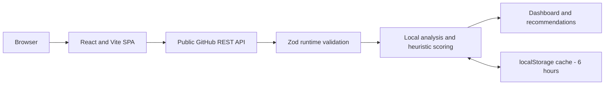

# GitHub Profile Analyser

GitHub Profile Analyser turns a public GitHub profile into a recruiter-oriented portfolio review with a heuristic score and actionable recommendations.

[](https://github.com/aicha-btn/github-profile-analyser/actions/workflows/ci.yml)

**Live application:** [https://github-profileanalyser.vercel.app](https://github-profileanalyser.vercel.app)

## Product overview

The application analyses public profile and repository metadata directly in the browser. It highlights portfolio signals that are easy for a recruiter to scan, calculates a score out of 100, and suggests concrete improvements for the profile and its repositories.

The score is a deterministic heuristic for prioritising visible portfolio improvements. It is not a scientific assessment, an official GitHub ranking, or a measure of employability.

## Key features

- Analyse a public GitHub username, profile, and paginated public repositories.
- Review repository descriptions, names, languages, demo links, stars, forks, archive/fork status, and update dates.
- Generate strengths, areas for improvement, and an actionable checklist.
- Switch between four recruiter perspectives: frontend apprenticeship, fullstack apprenticeship, web development internship, and junior React.
- Use **quick analysis** for profile and repository metadata with no README requests.
- Use **deep analysis** to inspect README content for up to five selected repositories.
- Cache quick and deep results separately in the browser for six hours.
- Explore the interface without GitHub requests through the built-in local demo mode.

## Screenshots

All dashboard screenshots use the built-in fictional demo dataset.

### Dashboard analysis


*Dashboard analysis with the heuristic score, category breakdown and profile insights.*

### Empty state


*Initial analysis flow with public GitHub username input and quick/deep modes.*

### Mobile dashboard

<p align="center">
  
</p>

<p align="center"><em>Responsive dashboard on a mobile viewport.</em></p>

## Architecture



There is no application backend, database, GitHub token, or server-side secret. GitHub requests, validation, analysis, scoring, and caching are handled by the browser.

## Scoring model

The total score is capped at 100 points:

- **Profile completeness:** 20
- **Repository quality:** 30
- **Portfolio readability:** 25
- **Activity:** 15
- **Technical diversity:** 10

The model uses simple, explainable signals from the public profile and repository metadata. Given the same input data, date, and recruiter perspective, it produces the same result. The score is a portfolio-review aid, not an employability metric.

## Tech stack

- **Frontend:** React 19.2.5, TypeScript 6.0.3, Vite 8.1.6, CSS
- **Data and validation:** browser Fetch API, Zod 4.6.7, localStorage
- **Quality:** Vitest 5.0.5, ESLint, TypeScript checks, GitHub Actions
- **Deployment:** Vercel

## Quality and CI

The test suite contains **52 automated tests across 4 test files**. It covers Zod validation, mocked GitHub API behaviour, rate-limit metadata, timeouts, README responses, pagination limits, cache validation, scoring invariants, date handling, and quick/deep analysis behaviour.

All GitHub API calls are mocked during tests: the suite makes **zero real GitHub requests** and requires no token or secret.

The GitHub Actions workflow runs on Node.js 22.x and executes:

```text
npm ci
npm test
npm run lint
npx tsc --noEmit
npm run build
npm audit --audit-level=critical
```

## GitHub API and resilience

The SPA uses the unauthenticated public GitHub REST API. The public GitHub rate limit therefore applies.

- Requests have a 12-second timeout backed by `AbortController`.
- Repository pagination uses 100 items per page with a hard cap of 5 pages, or 500 repositories.
- Quick analysis makes no README request.
- Deep analysis selects and inspects at most 5 repositories.
- README content is capped at 100,000 bytes before analysis.
- HTTP 403 and 429 responses are treated as rate-limit errors rather than missing resources.
- Runtime schemas reject incompatible GitHub responses before analysis.
- A six-hour browser cache reduces repeated requests without claiming to eliminate rate limits.

## Getting started

Node.js 22.12 or later is recommended. npm is the supported package manager.

```bash
git clone https://github.com/aicha-btn/github-profile-analyser.git
cd github-profile-analyser
npm ci
npm run dev
```

No environment variable, GitHub token, or `.env` file is required.

Run the local quality checks with:

```bash
npm test
npm run lint
npx tsc --noEmit
npm run build
```

## Limitations

- Requests are unauthenticated and subject to GitHub's public API quota.
- An analysis includes at most 500 public repositories; reaching the cap is reported as a partial result.
- Deep analysis inspects README content for at most five selected repositories.
- Activity signals use available repository metadata, including `updated_at`; the contribution graph is not retrieved.
- Scoring is heuristic and recruiter-oriented, not an objective quality or employability measure.
- Cached results remain local to the current browser; there is no authentication, remote history, database, or cross-device storage.

## Privacy and security

The application does not request or expose a GitHub token. Public GitHub data is fetched and analysed in the browser, with no proprietary application backend. Cached analyses stay in localStorage. GitHub responses are validated at runtime, remote errors are normalised before display, and network requests have a fixed timeout.

## Deployment

The public SPA is deployed on Vercel at [https://github-profileanalyser.vercel.app](https://github-profileanalyser.vercel.app).

## License

No explicit open-source license is currently provided.
